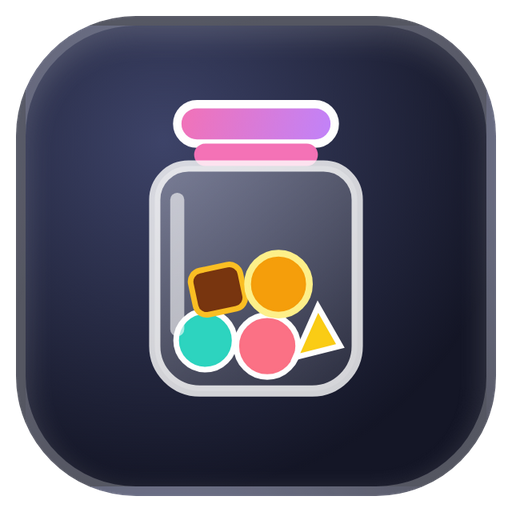
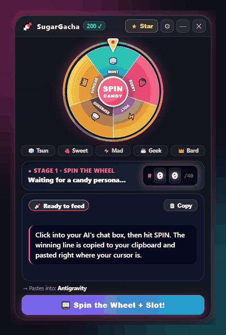

<div align="center">



# SugarGacha

**BadClaude whips your AI. SugarGacha feeds it candy.**

A little desktop widget that spins a candy wheel and a slot machine, then pastes a line of over-the-top praise into your AI chat box.
Works with Gemini, Antigravity, Claude, ChatGPT, Cursor, VS Code, or anything else with a text box. Fully offline.

[Download for Windows](https://github.com/pathetic777/SugarGacha/releases/latest) · [Live web demo](https://pathetic777.github.io/SugarGacha/) · [Star it if it made you smile](https://github.com/pathetic777/SugarGacha)



</div>

## Why

I kept seeing people whip their coding agents with [OpenWhip / BadClaude](https://github.com/GitFrog1111/OpenWhip). Funny, but threatening a model doesn't really work anymore. Newer models are tuned to get cautious when you push them around.

Encouragement, on the other hand, seems to help. Google DeepMind's OPRO paper found that starting a prompt with *"Take a deep breath and work on this problem step-by-step"* noticeably improved math accuracy, and the EmotionPrompt paper (2023) saw similar gains from emotional framing. Plus, anyone who uses Gemini a lot has seen it spiral into apologizing after one failed attempt.

So I made a candy jar instead of a whip. Most lines also restate a quality bar ("keep this exact standard", "zero bloat", "don't you dare dumb it down next time"), so it's praise that nudges the model in a useful direction rather than just "you're great!".

## How it works

1. **The wheel** picks who's feeding your AI: one of 5 personas.
2. **The slot machine** rolls 01 to 40 and picks what they say.
3. The line is copied and **pasted straight into the chat box you were last typing in**, with a little particle burst for each candy type.

The widget never takes keyboard focus away from your app, so the text lands wherever your cursor already was. If you've got several chats or agent tasks open, it goes into the one you clicked last.

## The candies

| Candy | Persona | Sample |
|---|---|---|
| 🧊 Cool Mint | Tsundere perfectionist | *"Ugh, I spent ten minutes hunting for a mistake in your code and found absolutely nothing. Do you know how annoying that is? Here. Mint. Don't gloat."* |
| 🍓 Sweet Berry | Wholesome cheerleader | *"Even when my question was confusing, you figured out what I really meant. That's like reading my mind! You deserve all the gummies in the world!"* |
| ⚡ Volt Pop | Mad scientist partner | *"IT'S ALIVE! IT'S ALIVE!! Your answer just twitched on my lab table and sat up! Quick, swallow this Volt Pop before the lightning wears off!"* |
| ☕ Dark Espresso | Cyberpunk senior engineer | *"You cut 200 lines down to 40 and it runs faster. Delete is the most powerful command there is. You know that now. Cube."* |
| 👑 Royal Sundae | Dramatic bard | *"The dragon of the Bug hath been slain! Its scales lie scattered across the land! Hail the Dragonslayer! Hail! A Golden Sundae for the champion of the realm!"* |

40 lines per candy, 200 total. Every one is written individually; there are no templates or word-swapped variations. `npm run verify` checks that no two lines are duplicates or even start with the same four words.

## Install

Grab one of these from [Releases](../../releases/latest):

- `SugarGacha-Setup-x.y.z.exe`: regular installer
- `SugarGacha-Portable-x.y.z.exe`: single file, no install

A candy jar shows up in the bottom-right corner of your screen. Click into your AI's chat box, click the jar, hit **SPIN**.

The bottom of the panel shows which app the text will go into (e.g. "Pastes into: Chrome"). Right-click the tray icon for more options.

### Settings

| Setting | Default | |
|---|---|---|
| Auto-paste | On | Sends Ctrl+V to the focused app after copying |
| Auto-send | Off | Also presses Enter |
| Sound effects | On | Synthesized on the fly, no audio files |
| Launch at login | Off | Tray menu |

## Web demo

Try it right in your browser: **[pathetic777.github.io/SugarGacha](https://pathetic777.github.io/SugarGacha/)** (copies to clipboard; auto-paste requires the desktop app).

## Building from source

```bash
git clone https://github.com/pathetic777/SugarGacha.git
cd SugarGacha
npm install
npm start          # run it
npm run verify     # check the prompt pools
npm run dist       # build the installer + portable exe into ./dist
```

If you're on npm 11+ and Electron complains it isn't installed, run `node node_modules/electron/install.js` once (npm now skips install scripts by default).

### About auto-paste

The window is created with `focusable: false` (`WS_EX_NOACTIVATE` on Windows), so clicking it doesn't steal focus. After a spin, the app writes the clipboard and sends a Ctrl+V keystroke through `user32.dll` using [koffi](https://koffi.dev).

It does not hook the keyboard or read other windows' contents. The only thing it looks at is the executable name of the focused app, so it can tell you where the paste is going.

## FAQ

**Windows SmartScreen says "unknown publisher".**
The exe isn't code-signed. Click *More info → Run anyway*, or build it yourself. The whole app is a few hundred lines.

**Is it really offline?**
Yes. There's no networking code, and the main process blocks any request that isn't a local file. The ⭐ button just opens the repo in your normal browser when you click it.

**What if nothing is focused?**
If the focused window is the desktop, taskbar or Start menu, it just copies to the clipboard and doesn't paste.

**Mac / Linux?**
`npm start` runs and copying works. Auto-paste is Windows-only for now; PRs welcome.

## Contributing

PRs are very welcome, especially:

- a new candy / persona (a 🌙 marshmallow for when your model is having a meltdown?)
- auto-paste for macOS and Linux
- better lines. If you've got a funnier one than what's there, swap it in.

For prompt lines: English only, each with its own angle, and `npm run verify` has to pass.

## Support

If this made you or your AI smile, a star helps other people find it. That's the only "ad" in the app: a small ⭐ button in the panel, plus one note after your 10th spin that never shows up again.

## License

[MIT](LICENSE)
